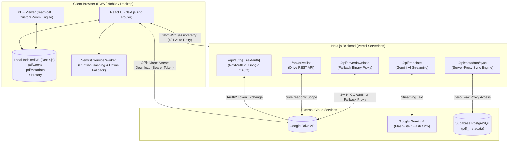

# Simple Reader (스마트 이북 리더기) 통합 개발 문서

## 1. 프로젝트 개요 (Project Overview)

**Simple Reader**는 구글 드라이브(Google Drive) 및 로컬 저장소에 보관된 대용량 PDF 문서를 0.1초 만에 불러와 쾌적하게 열람하고, 모르는 외국어 문장을 드래그하여 즉시 구글 제미나이(Gemini 2.0 Flash) AI로 실시간 번역 및 요약할 수 있는 **PWA 기반 스마트 이북 리더 웹 애플리케이션**입니다.

사내 보안망이나 방화벽 환경에서 구글 공식 Picker Iframe이 차단되는 한계를 극복하기 위해 자체적인 Google Drive REST API 탐색기를 구현하였으며, 대용량 PDF 바이너리 데이터를 브라우저 로컬 저장소(IndexedDB / Dexie.js)에 우선 캐싱하는 **오프라인 퍼스트(Offline-First)** 설계를 채택했습니다. 사용자가 작성한 독서 메모와 책갈피는 Vercel 서버의 API 프록시(`/api/metadata/sync`)를 통해 안전하게 클라우드(Supabase PostgreSQL)에 자동 양방향 동기화되며, 다중 기기(PC, 태블릿, 모바일) 간에 동일한 독서 환경을 제공합니다.

---

## 2. 시스템 아키텍처 및 데이터 흐름 (System Architecture)



### **핵심 데이터 흐름 요약**
1. **PDF 2단계 하이브리드 다운로드(Direct-First, Proxy-Fallback) 및 로컬 캐싱**:
   - `DrivePickerModal`에서 파일을 선택하면, Vercel 서버 대역폭 절약과 속도 극대화를 위해 **1순위로 브라우저가 Google Drive API에서 직접(Direct) 스트리밍 다운로드**를 수행하며 실시간 진행률(`DownloadProgressModal`)을 표시합니다.
   - 만약 CORS 정책이나 사내 보안망 제약으로 직접 다운로드가 실패할 경우, 사용자 확인(`proxy_confirm`)을 거쳐 **2순위인 백엔드 프록시(`/api/drive/download`)**로 안전하게 우회 다운로드합니다.
   - 받아온 `ArrayBuffer`는 브라우저의 `Dexie.js`(`pdfCache`)에 즉시 영구 저장되어, 재방문 시 네트워크 요청 없이 **0.1초 만에 로컬에서 즉각 렌더링**됩니다.
2. **AI 실시간 번역·요약 및 히스토리**:
   - 사용자가 PDF 문장을 드래그(또는 직접 입력)하면 플로팅 툴팁이 팝업되며, 번역/요약 요청 시 `/api/translate` 엔드포인트를 통해 선택한 Gemini 모델(`flash-lite`, `flash`, `pro`) 및 커스텀 프롬프트와 함께 실시간 스트리밍 통신(`ReadableStream`)을 수행합니다.
   - 질의 내역은 로컬 DB(`aiHistory`)에 자동 보관(파일당 최대 50개 롤링)되어 이전 질의 결과를 언제든 원문과 함께 즉각 복원할 수 있습니다.
3. **하이브리드 서버 프록시 메타데이터 동기화 (Hybrid Server-Proxy Sync)**:
   - 메모 및 책갈피는 생성 즉시 로컬 DB(`pdfMetadata`)에 반영(UI 딜레이 제로)된 뒤, 백그라운드에서 `/api/metadata/sync` 라우트로 일괄 전송(Upsert)됩니다.
   - 브라우저에 Supabase 접속 키가 노출되지 않으며, 서버가 NextAuth 세션을 기반으로 사용자 신원을 검증하고 권한을 강제 부여한 뒤 Supabase DB에 안전하게 보관합니다.

---

## 3. 기술 스택 및 개발 프레임워크 (Tech Stack)

### **프론트엔드 (Frontend)**
- **Framework**: Next.js 16.2 (App Router), React 19
- **Language**: TypeScript 5 (엄격한 타입 체크 및 무결성 보장)
- **Styling**: Tailwind CSS v4 (CSS 변수 기반 다크/라이트 테마 디자인 토큰 시스템)
- **State Management**: Zustand (`persist` 미들웨어를 통해 마지막 열람 파일, 보기 모드, 테마 상태를 `localStorage`에 영속화)
- **Data Fetching & Offline Control**: `@tanstack/react-query` (오프라인 시 불필요한 재시도 즉시 차단 및 온라인 복구 시 자동 리페치)
- **Icons & Typography**: `lucide-react`, Google Material Symbols Outlined, Inter, Merriweather
- **UI Panels & Layout**: `react-resizable-panels` (데스크탑 좌우 너비 조절), 자체 개발 `MobileBottomSheet` (모바일 상하 제어)
- **PDF Rendering & Interaction**:
  - `react-pdf` (v9.1.0) & `pdfjs-dist` (v3.11.174) — SSR 충돌 방지 및 Next.js 웹팩 컴파일러 호환성 최적화
  - `react-zoom-pan-pinch` — 모바일 터치 및 핀치 줌을 위한 베이스 라이브러리 (13대 자체 안정화 패치 탑재)
- **Client Database**: `Dexie.js` & `dexie-react-hooks` (`useLiveQuery` 기반 리액티브 로컬 캐시 관리)
- **PWA**: `@serwist/next` & `serwist` (고성능 서비스 워커, 오프라인 런타임 캐싱, 앱 매니페스트)

### **백엔드 및 서버리스 API (Backend & API)**
- **Authentication**: NextAuth.js v5 Beta (Google OAuth 2.0, `drive.readonly` 스코프 적용)
- **AI Integration**: `@google/genai` (Google Gemini `flash-lite` / `flash` / `pro` 모델 선택 지원, 실시간 Chunk Streaming 출력)
- **Cloud Database**: `Supabase JS Client` (PostgreSQL 기반, `server-only` 패키지로 백엔드 API 라우트 내에서만 엄격히 구동)
- **Validation**: `zod` (API 엔드포인트 요청 파라미터 및 본문 엄격 검증)
- **Network Resilience**: 자체 구현 `fetchWithSessionRetry` (401 토큰 만료 감지 시 세션 자동 갱신 및 투명 재시도)

### **테스트 및 빌드 도구 (Testing & Tooling)**
- **Testing**: `Jest`, `@testing-library/react`, `@testing-library/user-event`, `msw`, `puppeteer`
- **Image Processing**: `sharp` (앱 아이콘 리사이징 스크립트 등)

---

## 4. 폴더 구조 및 주요 소스 파일 명세 (Directory Structure)

```text
simple-reader/
├── app/
│   ├── layout.tsx                     # 전역 레이아웃. PWA Manifest, Apple Web App 메타데이터, 폰트, Provider 세팅
│   ├── sw.ts                          # Serwist 서비스 워커. 5대 런타임 캐싱 전략 및 오프라인 핸들러 정의
│   ├── page.tsx                       # 메인 진입점. Header 및 Workspace 렌더링
│   ├── globals.css                    # Tailwind CSS v4 지시어 및 다크/라이트 테마 토큰 정의
│   └── api/                           # 백엔드 API 라우트 (Node.js Serverless)
│       ├── auth/[...nextauth]/route.ts# NextAuth v5 구글 로그인 및 토큰 갱신 엔드포인트
│       ├── drive/list/route.ts        # 구글 드라이브 내 PDF 파일/폴더 목록 조회 (자체 브라우징)
│       ├── drive/download/route.ts    # 구글 드라이브 파일 바이너리(ArrayBuffer) 우회 다운로드 프록시
│       ├── metadata/sync/route.ts     # Supabase 메타데이터 동기화 프록시 (GET/POST/DELETE)
│       └── translate/route.ts         # 제미나이 AI 번역/요약 스트리밍 엔드포인트 (모델/커스텀 프롬프트 지원)
├── components/
│   ├── Providers.tsx                  # NextAuth SessionProvider 및 React Query QueryClientProvider 래퍼
│   ├── Header.tsx                     # 상단 헤더. 로고 버튼(앱 정보 모달), 파일명(도서 정보 모달), 오프라인 배지, 테마, 로그인
│   ├── Workspace.tsx                  # 메인 작업 영역. 데스크탑(좌우 분할) / 모바일(상하 시트) 레이아웃
│   ├── PdfViewer.tsx                  # 줌/스크롤 13대 엔진 적용 PDF 뷰어, 텍스트 드래그 플로팅 툴팁
│   ├── AiAssistantPanel.tsx           # AI 번역/요약(모델 선택·프롬프트), 번역 히스토리, 메모·책갈피 관리 및 휴지통
│   ├── DrivePickerModal.tsx           # 구글 드라이브 탐색기 모달 (폴더 서재 핀 고정 기능 포함)
│   ├── StorageManagerModal.tsx        # 로컬 저장소 관리자 UI ('내 서재', 캐시/메타데이터 통계 확인 및 삭제)
│   ├── BookInfoModal.tsx              # 현재 열린 PDF 도서 정보(파일명, 용량, 활성 메모/책갈피 개수) 확인 모달
│   ├── DownloadProgressModal.tsx      # 구글 드라이브 파일 다운로드 진행률(%) 표시 및 프록시 우회 확인 모달
│   ├── MobileBottomSheet.tsx          # 모바일 전용 하단 드래그블 시트 (AI 패널 및 메모 연동)
│   └── BottomNavBar.tsx               # 모바일 환경 전용 하단 고정 네비게이션 툴바
├── hooks/
│   ├── usePdfFile.ts                  # Dexie 캐시 1순위 확인 및 Direct/Proxy 2단계 드라이브 다운로드 관리 훅
│   ├── useMetadataSync.ts             # 로컬 Dexie와 Supabase(서버 프록시 경유) 간 하이브리드 동기화 훅
│   └── useNetworkStatus.ts            # 15초 주기 능동 핑(/manifest.json) 기반 초정밀 온/오프라인 감지 훅
├── store/
│   └── useStore.ts                    # Zustand 전역 상태 및 localStorage 자동 영속화(persist) 설정
├── lib/
│   ├── db.ts                          # Dexie.js 스키마 정의 (pdfCache, pdfMetadata, aiHistory 테이블 및 통계 유틸)
│   ├── fetchWithSessionRetry.ts       # 401 Unauthorized 감지 시 세션 자동 리프레시 및 투명 1회 재시도 헬퍼
│   ├── supabase.ts                    # Supabase 클라이언트 ('server-only' 격리, 안전한 서버 전용 DB 클라이언트)
│   └── constants.ts                   # 앱 버전 정보, 안내 문구 등 UI 공용 상수 관리
├── types/
│   └── next-auth.d.ts                 # NextAuth 세션 및 JWT 커스텀 타입 확장 정의
├── __tests__/                         # 컴포넌트, 훅, 스토어 단위/통합 테스트 스위트 (Jest)
├── auth.ts                            # NextAuth v5 환경설정. 구글 OAuth 자격증명 및 리프레시 토큰 로직
└── next.config.ts                     # Serwist PWA 플러그인 연동 및 6대 강력 HTTP 보안 헤더 설정
```

---

## 5. 상세 기능 명세 (Feature Specifications)

### 1. 구글 드라이브 연동, 자체 파일 탐색기 및 2단계 다운로드 (`DrivePickerModal`, `DownloadProgressModal`)
- **OAuth 2.0 기반 안전한 인증**: Google Drive `drive.readonly` 스코프를 통해 사용자의 드라이브 파일 읽기 권한만 안전하게 획득합니다.
- **사내 보안망 우회 자체 탐색기**: 구글 기본 Picker의 Iframe 차단 이슈를 원천 해결하기 위해 Drive REST API(`v3`)를 직접 조회하는 커스텀 UI를 구축했습니다.
- **'내 서재' 폴더 핀(Pin) 고정**: PDF가 모여있는 특정 폴더로 이동한 후 상단의 핀(`[📌]`) 버튼을 누르면 해당 폴더가 기본 서재로 저장되어 다음 접속 시 해당 폴더로 자동 진입합니다.
- **Direct-First / Proxy-Fallback 다운로드**: 파일 선택 시 실시간 진행률 바(`%`, `MB`)를 보여주며 브라우저 직접 다운로드를 우선 시도하고, CORS나 네트워크 제약으로 실패할 경우에만 사용자의 동의를 거쳐 Vercel 프록시 서버(`/api/drive/download`)로 우회 다운로드합니다.

### 2. 비로그인 및 오프라인 로컬 PDF 직접 열람 (`local-*` 모드)
- **네이티브 파일 선택기 연동**: 로그아웃 상태이거나 오프라인 환경인 경우 브라우저 파일 선택기(`<input type="file">`)를 호출하여 기기에 저장된 PDF를 즉시 로컬 캐시(`Dexie.js`)로 복사해 열람할 수 있습니다.
- **클라우드 동기화 원천 격리**: 기기에서 직접 연 파일은 `local-[UUID]` 형식의 고유 ID가 부여되며, 이후 사용자가 구글 로그인을 하더라도 백그라운드 동기화 봇(`manualSync`)이 의도적으로 건너뛰어(Bypass) 개인 문서의 외부 유출을 원천 방지합니다.

### 3. 고성능 PDF 뷰어, 자동 이어읽기 및 도서 정보 (`PdfViewer`, `BookInfoModal`)
- **다양한 보기 모드 및 상태 유지**: 단일 페이지 보기 및 세로 스크롤 연속 보기(Continuous Mode)를 지원하며, 마지막으로 읽던 파일과 보기 모드가 `localStorage`에 기억되어 재접속 시 즉시 이어 읽을 수 있습니다.
- **멀티 디바이스 줌 인터랙션**: PC 마우스 휠(`Ctrl+Wheel`), 더블클릭, 모바일 두 손가락 핀치 줌(Pinch-to-zoom)을 모두 지원하며 지연 렌더링 스무딩을 통해 렉 없는 60fps 줌을 보장합니다.
- **텍스트 캡처 플로팅 툴팁**: PDF 문장을 드래그하면 선택 영역 상단에 플로팅 툴바가 즉시 표시되어 클릭 한 번으로 `한국어로 번역`, `요약`, `메모 추가`를 실행할 수 있습니다.
- **도서 정보 모달 (`BookInfoModal`)**: 상단 헤더에 표시된 현재 열람 중인 PDF 파일명을 클릭하면, 파일 전체 제목과 용량(MB), 현재 문서에 작성된 활성 메모 및 책갈피 개수를 요약해 보여줍니다.

### 4. 제미나이 AI 번역/요약, 모델·프롬프트 커스텀 및 히스토리 (`AiAssistantPanel`)
- **실시간 스트리밍 답변 및 직접 입력 지원**: PDF에서 드래그한 문장뿐만 아니라 입력창에 직접 텍스트를 타이핑하거나 수정하여 질의할 수 있으며, 토큰 단위 실시간 스트리밍 출력을 지원합니다.
- **AI 모델 선택 및 커스텀 프롬프트**:
  - 드롭다운을 통해 **`gemini-flash-lite-latest` (기본값)**, **`gemini-flash-latest`**, **`gemini-pro-latest`** 중 원하는 모델을 실시간으로 선택할 수 있습니다.
  - 추가 요청사항 입력창(기본값: `"설명 없이 번역한 결과만"`)을 통해 `"경어체로 번역"`, `"전문용어 원문 병기"` 등 사용자 맞춤 지시사항을 즉시 반영할 수 있습니다.
- **AI 질의 히스토리 자동 보관 (Auto Pruning)**:
  - 번역이나 요약을 실행할 때마다 캡처한 원문 문장, AI 답변, 페이지 번호가 로컬 `aiHistory` 테이블에 자동 저장됩니다.
  - 파일당 **최대 50개**의 최신 내역만 유지하며 초과 시 가장 오래된 기록을 자동 삭제하여 용량을 최적화합니다.
  - '선택된 문장' 영역 좌측의 히스토리(`history`) 버튼을 눌러 과거 내역을 조회하고, 특정 항목을 클릭하면 당시의 원문과 AI 답변이 입력창에 즉시 복원됩니다.

### 5. 하이브리드 메모장, 책갈피 및 휴지통 복구 시스템
- **초고속 로컬 반영, 정렬 및 페이지 점프**: 메모 작성 및 책갈피 추가 시 로컬 IndexedDB에 즉시 저장된 후 백그라운드에서 클라우드로 동기화됩니다. 목록은 **최신순 / 페이지순**으로 정렬할 수 있으며, 항목 클릭 시 해당 PDF 페이지로 즉시 이동합니다.
- **Soft Delete(논리적 삭제) 및 휴지통 모드**:
  - 메모/책갈피 삭제 시 데이터를 즉시 파괴하지 않고 `deleted_at` 타임스탬프를 부여합니다.
  - `메모·책갈피` 탭 상단의 휴지통(`delete`) 아이콘을 누르면 최근 삭제된 항목들만 모아볼 수 있는 휴지통 모드로 전환되며, 버튼 아이콘이 뒤로가기(`arrow_back`, "이전 목록으로 돌아가기")로 변경되어 현재 모드를 직관적으로 구별해 줍니다.
  - 휴지통에서 '복구하기' 버튼을 누르면 로컬과 클라우드 DB 모두에서 삭제 플래그가 해제되어 완벽히 복원됩니다.
  - 30일이 경과한 오래된 삭제 데이터는 클라이언트 동기화 루틴에 의해 로컬과 서버 양쪽에서 영구(물리) 삭제됩니다.

### 6. 로컬 저장소 관리자 ('내 서재', `StorageManagerModal`)
- **통합 서재 현황 시각화**: 기기에 바이너리가 캐시된 PDF(`드라이브 (캐시됨)`, `기기 파일 (오프라인 전용)`)뿐만 아니라, 캐시는 비워졌지만 클라우드/로컬에 메모·책갈피 기록이 남아있는 문서(`드라이브에만 있음`)까지 통합하여 용량(MB), 메모 수, 책갈피 수, 최종 열람일을 한눈에 보여줍니다.
- **항목 클릭 즉시 열람 및 데이터 정리**: 목록의 책을 클릭하면 즉시 해당 책을 뷰어에서 열며, 개별 항목 삭제 또는 전체 삭제 시 로컬 PDF 캐시와 로컬/서버의 메타데이터를 깔끔하게 일괄 정리합니다.

### 7. 앱 정보 모달 및 개인정보 보호 연동 (`Header`)
- **헤더 로고 인터랙션**: 헤더 좌측의 `menu_book` 아이콘뿐만 아니라 `Simple Reader` 타이틀 텍스트 전체를 클릭하여 앱 정보 창을 팝업할 수 있습니다.
- **테마 감응형 앱 아이콘**: 다크모드에서는 밝은 블루(`#d0ebff`), 라이트모드에서는 딥 블루(`#0044cc`)로 로고와 동일한 디자인의 앱 아이콘이 모달 상단에 렌더링됩니다.
- **원클릭 서비스 워커 캐시 갱신**: "최신 버전으로 업데이트" 버튼을 누르면 기기에 등록된 서비스 워커 등록을 해제하고 캐시 스토리지를 전체 삭제한 뒤 앱을 강제 리로드합니다. (IndexedDB의 PDF 및 메모 데이터는 안전하게 보존됨)
- **개인정보처리방침 외부 링크**: 모달 하단 좌측에 공식 개인정보처리방침(`https://landing-doohee2.vercel.app/privacy`) 링크를 배치하여 신뢰성을 확보했습니다.

---

## 6. 핵심 컴포넌트 동작 원리 및 트러블슈팅 (Core Mechanisms & Troubleshooting)

### **A. PDF 뷰어 줌/스크롤 13대 고도화 엔진 (`PdfViewer.tsx`)**
1. **앵커(Anchor) 기반 좌표 추적 및 `flushSync` 동기화 (스크롤 튐 방지)**:
   - 줌 이벤트 발생 시 뷰포트 내의 클릭 포인트나 손가락 핀치 중심점을 기억하여, 해당 지점이 위치한 페이지 돔(`.react-pdf__Page`)과 상대적 비율(X%, Y%)을 저장합니다.
   - `react-zoom-pan-pinch`의 CSS transform을 초기화한 후 `flushSync`로 React 렌더 트리를 동기 리플로우(Reflow)하고, 재계산된 화면 좌표에 맞게 `scrollLeft/scrollTop`을 보정하여 사용자가 읽고 있던 텍스트 위치를 한 픽셀의 오차 없이 고정합니다.
2. **모바일 핀치 줌 정확도 향상**:
   - `onTouchMove` 이벤트에서 두 손가락의 정확한 중심점(`pinchCenterRef`)을 초당 수십 회 추적하여 '사용자가 꼬집은 위치'를 정확한 줌 기준으로 삼습니다.
   - 라이브러리의 상대적 스케일을 기존 스케일에 직접 곱하여 연속 핀치 줌 시 배율 왜곡을 방어합니다.
3. **CSS Safe-Centering 기법 (좌측 스크롤 잘림 제한 해제)**:
   - Flexbox의 `align-items: center` 적용 시 뷰포트를 초과하는 문서의 좌측이 잘려 스크롤할 수 없는 고질적 결함을 해결하기 위해 컨테이너를 `items-start`로 지정하고 내부 페이지에 `mx-auto w-max`를 적용했습니다. (작을 때는 중앙 정렬, 클 때는 좌측 벽 기준으로 팽창).
4. **1손가락 터치 완벽 분리 및 핀치 줌 종료 폭주 방어 (Last Good State)**:
   - 줌 라이브러리가 1손가락 스크롤을 가로채지 못하도록 터치 1개(`e.touches.length === 1`)는 `e.stopPropagation()`으로 차단합니다.
   - 두 손가락 중 한 손가락이 먼저 떨어지는 찰나 라이브러리가 패닝으로 오인해 좌표가 급변하는 버그를 막기 위해, 정상 핀치 상태(`onPinch`)에서 기록된 마지막 정상 값(`lastGoodPinchStateRef`)만 최종 배율 커밋에 사용합니다.
5. **모바일 텍스트 드래그 선택 안정화 (`selectionchange`)**:
   - 모바일 핸들 드래그 완료 시점을 정확히 감지하기 위해 `document` 레벨의 `selectionchange` 이벤트를 300ms 디바운스로 추적하여 텍스트 선택 즉시 AI 패널로 전송합니다.
6. **핀치 줌 중복 확대(Double-Scaling) 버그 해결**:
   - 라이브러리의 비동기 RAF 애니메이션이 스케일을 덮어쓰며 배율이 121%로 증폭되는 현상을 막기 위해, 스케일 커밋 직전 `cancelAnimationFrame(instance.animation)`으로 진행 중인 애니메이션을 강제 취소합니다.
7. **ArrayBuffer Detachment 에러 방지**:
   - `react-pdf`가 ArrayBuffer 소유권을 Web Worker로 넘기면서 원본 길이가 0바이트로 분리(Detached)되는 현상을 방지하기 위해, 렌더링 직전 `ArrayBuffer.slice(0)`로 독립적인 복사본을 만들어 Worker에 전달합니다.
8. **핀치 줌 깜빡임(Flickering) 개선 (Crossfade 유지)**:
   - `<Page>` 컴포넌트의 `loading` 속성에 스피너를 할당할 경우 새 캔버스를 그리는 동안 기존 화면이 사라지는 문제를 해결하기 위해, `loading` 속성을 비워 `react-pdf`의 기본 동작인 '새 캔버스 완료 시까지 기존 캔버스 유지(Crossfade)'를 유도했습니다.
9. **배율 목표치 미달(Undershoot) 보정 (Peak Scale Smoothing)**:
   - 손가락을 뗄 때 미세하게 간격이 좁아지는 롤링 동작을 보정하기 위해 최근 300ms 동안의 스케일 기록 중 피크 배율(Peak Scale)을 찾아 스냅(Snap)합니다.
10. **OOM(메모리 초과) 크래시 방지 및 동적 배율 제한**:
    - 빠른 핀치 줌 반복 시 탭 강제 종료를 막기 위해 최대 배율을 5.0으로 안전하게 제한하고, `TransformWrapper`의 스케일 경계를 동적으로 하드 블록(Hard Block)합니다.
11. **마우스 휠(Ctrl+Wheel) 줌 네이티브 가로채기 및 지연 렌더링**:
    - 브라우저 네이티브 줌과의 충돌을 막기 위해 최상위 `window` 레벨에서 `wheel` 이벤트를 `capture: true`로 가로채 `preventDefault()`를 호출합니다.
    - 휠을 돌리는 동안에는 가벼운 CSS `transform`만 60fps로 적용하고, 휠 조작이 끝난 후 150ms 뒤에 단 한 번만 고해상도 렌더링을 커밋합니다.
12. **연속 보기 모드 페이지 간격 동적 연동**:
    - CSS 변수 `--pdf-scale`을 주입하여 배율 변동에 비례하여 페이지 사이 여백이 자연스럽게 유지되도록 계산식(`calc(4px * var(--pdf-scale))`)을 적용했습니다.
13. **줌 커밋 시 CSS Transition 충돌 방지**:
    - transform 초기화 시 브라우저 전환 효과가 개입하여 화면이 축소되었다가 커지는 깜빡임을 막기 위해, 초기화 전후 및 `flushSync` 직후에 `transition: none !important`를 강제 주입합니다.

---

### **B. 하이브리드 서버 프록시 동기화 엔진 (`useMetadataSync.ts` & `/api/metadata/sync`)**
1. **서버 API 프록시 전환 배경 (다중 앱 보안 격리)**:
   - 하나의 Supabase 인스턴스를 여러 애플리케이션이 공유하는 환경에서 브라우저에 `NEXT_PUBLIC_SUPABASE_ANON_KEY`를 노출하면 잠재적 보안 위험이 발생할 수 있습니다.
   - 이를 원천 차단하기 위해 브라우저에서 Supabase SDK를 완전히 제거하고, 모든 요청이 Next.js 서버 라우트(`/api/metadata/sync`)를 경유하도록 개편했습니다.
   - `lib/supabase.ts`에 `import "server-only"`를 적용하여 클라이언트 번들에 DB 코드가 섞이는 것을 빌드 타임에 차단합니다.
2. **서버 세션 강제 인가 (Session Overriding)**:
   - 클라이언트가 변조된 `user_id`를 담아 API로 보내더라도, 백엔드 API 라우트에서 `auth()`를 통해 세션 쿠키를 검증하고 진짜 구글 계정 식별자(`userId`)로 데이터를 강제 덮어씌워 타인의 데이터를 조작하거나 조회하는 공격을 원천 차단합니다.
3. **이메일 기반 사용자 식별자 단일화**:
   - 구글 OAuth 특성상 기기나 브라우저에 따라 `user.id(sub)`가 다르게 발급되는 현상을 방지하기 위해 변하지 않는 구글 계정의 `email`을 최우선 식별자로 통일했습니다.
4. **비로그인 지연 동기화 (`isUnsynced: true`)**:
   - 로그아웃 상태에서 작성된 메모/책갈피는 `isUnsynced: true` 플래그와 함께 로컬에 보관되며, 사용자가 로그인하는 순간 동기화 훅이 이를 감지하여 클라우드로 일괄 병합(Batch Upsert)합니다.

---

### **C. 세션 지속성 및 자동 복구 (Session Persistence)**
1. **치명적/일시적 실패 분리 (`auth.ts`)**:
   - Access Token 갱신 실패를 `invalid_grant`(권한 철회 등 치명적 오류)와 일시적 네트워크 오류로 구분했습니다. 일시적 실패 시 강제 로그아웃을 유발하지 않고 기존 토큰을 유지해 UX 단절을 방지합니다.
2. **`fetchWithSessionRetry` 공용 헬퍼 도입**:
   - API 호출 중 401(토큰 만료) 응답을 만나면 내부적으로 NextAuth의 `getSession()`을 호출해 토큰을 최신으로 갱신한 뒤, 투명하게 1회 자동 재시도합니다. (드라이브 목록, 다운로드, AI 번역, 동기화 전반에 적용).
3. **사전 갱신(Early Refresh) 및 180일 장기 세션**:
   - 토큰 만료 60초 전부터 사전 갱신을 시도하며, 브라우저 세션 쿠키 수명(`maxAge`)을 **180일**로 대폭 연장하여 재로그인 피로도를 최소화했습니다.

---

### **D. PWA 오프라인 우선(Offline-First) 설계 및 캐시 보안**
1. **5대 정밀 서비스 워커 런타임 캐싱 전략 (`sw.ts`)**:
   - **외부 리소스** (Google Fonts, OAuth 아바타): `StaleWhileRevalidate` (유효기간 30일).
   - **내부 정적 자산** (`/_next/static/**`, 이미지/CSS): `CacheFirst` (유효기간 1년, 제로 레이턴시).
   - **HTML 문서**: `StaleWhileRevalidate` (캐시 앱 셸 즉시 반환 후 백그라운드 갱신).
   - **Next.js RSC 데이터**: `StaleWhileRevalidate` (오프라인 페이지 전환 보장).
   - **API 라우트** (`/api/*`): `NetworkFirst` (5초 타임아웃, 오프라인 시 로컬 폴백).
2. **초정밀 능동 회선 판독기 (`useNetworkStatus.ts`)**:
   - `navigator.onLine`의 가짜 온라인 신호에 속지 않도록, 15초 주기 및 윈도우 포커스 시 `/manifest.json?_t=...`로 `HEAD` 요청(1.2초 타임아웃)을 날려 실제 통신 가능 여부를 검증합니다.
   - 오프라인 판정 시 React Query 재시도를 즉각 차단하여 무한 로딩을 방지하고 헤더에 빨간색 오프라인 펄스 배지를 띄웁니다.
3. **로그아웃 시 오프라인 캐시 폭파 (Cache Purging)**:
   - 공용 PC 환경 보호를 위해 로그아웃 클릭 시 `window.caches.keys()`를 순회하여 브라우저에 저장된 서비스 워커 캐시를 완전히 삭제합니다.

---

### **E. 보안 하드닝 (Zero-Leak & Security Hardening)**
1. **환경변수 격리 (Zero-Leak)**:
   - `GEMINI_API_KEY`, `GOOGLE_CLIENT_SECRET`, `NEXTAUTH_SECRET`, `SUPABASE_URL`, `SUPABASE_ANON_KEY` 등 모든 기밀 키에서 `NEXT_PUBLIC_` 접두사를 완전히 제거하여 브라우저 자바스크립트 번들에 포함되지 않도록 보장합니다.
2. **입력 검증 및 에러 메시지 위생화**:
   - 모든 API 요청은 `zod` 스키마를 통해 검증하며, 외부 통신 오류 시 상세 스택 트레이스는 서버 콘솔에만 남기고 클라이언트에는 `"요청을 처리할 수 없습니다."` 또는 표준 에러 포맷으로 위생화하여 반환합니다.
3. **Vercel 6대 강력 HTTP 보안 헤더 (`next.config.ts`)**:
   - `Content-Security-Policy` (CSP): 안전한 외부 폰트/CDN만 허용하고 비인가 스크립트 실행 차단
   - `Strict-Transport-Security` (HSTS): 2년간 HTTPS 접속 강제
   - `X-Frame-Options`: `DENY` (iframe 클릭재킹 차단)
   - `X-Content-Type-Options`: `nosniff` (MIME 스니핑 방지)
   - `Referrer-Policy`: `strict-origin-when-cross-origin`
   - `Permissions-Policy`: `camera=(), microphone=(), geolocation=()`

---

## 7. 환경 변수 설정 (.env.local)

앱 실행 및 배포를 위해 아래 환경 변수들이 안전하게 구성되어야 합니다.

```ini
# Google OAuth 자격 증명 (Google Cloud Console)
GOOGLE_CLIENT_ID=your-google-client-id.apps.googleusercontent.com
GOOGLE_CLIENT_SECRET=your-google-client-secret

# NextAuth v5 설정
NEXTAUTH_URL=http://localhost:3000   # 배포 시 실제 도메인 (예: https://simple-reader.vercel.app)
NEXTAUTH_SECRET=your-random-secret-key-32-chars-minimum

# Google Gemini AI API 키 (Google AI Studio)
GEMINI_API_KEY=AIzaSyYourGeminiApiKeyHere

# Supabase 백엔드 전용 자격 증명 (NEXT_PUBLIC_ 접두사 없음, 서버 API 프록시 전용)
SUPABASE_URL=https://your-project.supabase.co
SUPABASE_ANON_KEY=your-supabase-anon-key
```

> [!IMPORTANT]
> **Vercel 배포 시 주의사항**: `SUPABASE_URL` 및 `SUPABASE_ANON_KEY`는 브라우저가 아닌 Vercel Serverless Function에서만 사용되므로 환경변수 이름에 `NEXT_PUBLIC_`을 붙이지 않아야 완벽한 정보 은닉이 유지됩니다.

---

## 8. 기능 테스트 가이드 (Testing & Verification Guide)

### **핵심 시나리오별 검증 체크포인트**
1. **Google OAuth 로그인 및 자동 세션 복구**:
   - 우측 상단 `Google 로그인` 클릭 후 `drive.readonly` 권한을 승인합니다.
   - 브라우저 개발자 도구(F12) Application -> Cookies에서 `authjs.session-token`이 180일 유효기간의 HttpOnly 쿠키로 발행되었는지 확인합니다.
2. **자체 Picker 및 로컬 캐싱 (0.1초 렌더링)**:
   - `드라이브 파일 열기`를 눌러 폴더를 탐색하고 핀(`[📌]`)을 클릭해 '내 서재'로 지정합니다.
   - PDF를 열람한 후 브라우저 새로고침을 수행했을 때, 다운로드 로딩 없이 IndexedDB(`SimpleReaderDB -> pdfCache`)에서 **0.1초 만에 즉각 렌더링**되는지 확인합니다.
3. **텍스트 드래그 및 Gemini 실시간 스트리밍**:
   - 본문 영어 텍스트를 마우스나 터치로 드래그하여 플로팅 툴팁의 `한국어로 번역`을 클릭합니다.
   - 우측 AI 패널에서 실시간으로 글자가 타이핑되듯 스트리밍 출력되는지 확인합니다.
   - '선택된 문장' 좌측의 시계(히스토리) 아이콘을 눌러 방금 번역한 내역이 등록되었는지 확인하고, 클릭 시 복원되는지 검증합니다.
4. **하이브리드 메타데이터 동기화 (Server Proxy)**:
   - 번역 내용을 메모로 저장하거나 상단 책갈피 버튼을 클릭합니다.
   - 네트워크 탭에서 브라우저가 Supabase로 직접 통신하지 않고, **`POST /api/metadata/sync`**를 호출하여 정상적으로 200 응답을 받는지 확인합니다.
   - Supabase 콘솔 대시보드의 `pdf_metadata` 테이블에 데이터가 정상 등록되었는지 검증합니다.
5. **휴지통 모드 및 복구 테스트**:
   - 작성한 메모나 책갈피를 삭제합니다. 목록에서 즉시 사라지는 것을 확인합니다.
   - 상단 휴지통 아이콘을 클릭하여 휴지통 모드로 전환하고, 삭제된 항목이 목록에 나타나는지 확인합니다.
   - '복구하기' 버튼을 클릭하면 원래 목록으로 복원되고 Supabase의 `deleted_at`이 `null`로 초기화되는지 확인합니다.
6. **오프라인 모드 및 로컬 파일 격리 테스트**:
   - 개발자 도구 Network 탭을 `Offline`으로 전환합니다. 헤더 좌측에 빨간색 `오프라인` 배지가 펄스 애니메이션으로 나타나는지 확인합니다.
   - 캐시된 PDF가 끊김 없이 열리고, 오프라인 상태에서 작성한 메모에 '구름(동기화 대기)' 표시가 뜨는지 확인합니다.
   - 네트워크를 다시 `Online`으로 복구했을 때 10분 주기 폴링 또는 수동 동기화 버튼을 통해 구름 표시가 사라지며 서버로 업로드되는지 검증합니다.
7. **앱 정보 모달 인터랙션**:
   - 헤더 좌측의 로고 아이콘이나 `Simple Reader` 글자를 클릭해 모달이 정상 팝업되는지 확인합니다.
   - 다크/라이트 테마 전환 시 모달 상단 앱 아이콘 색상이 조화롭게 바뀌는지 확인합니다.
   - 하단 좌측의 `개인정보처리방침` 링크 클릭 시 새 탭으로 올바르게 열리는지 확인합니다.
